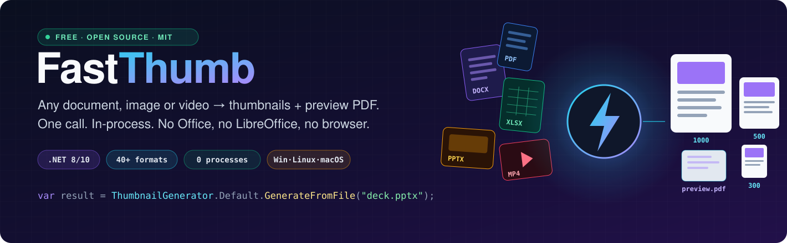
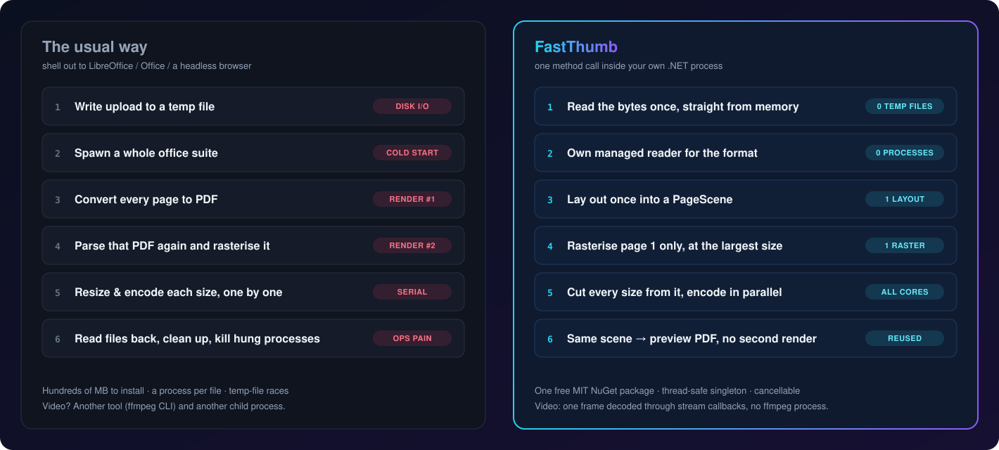
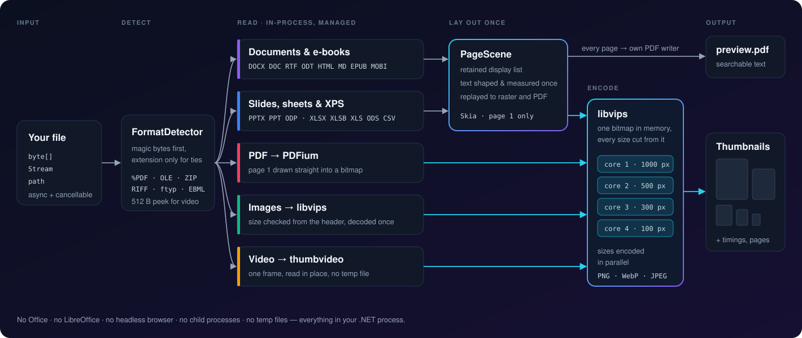

# FastThumb

<p align="center">
  
</p>

<p align="center">
  <a href="https://github.com/nsknet/FastThumb/actions/workflows/ci.yml"></a>
  <a href="https://www.nuget.org/packages/FastThumb"></a>
  <a href="LICENSE"></a>
  
  
  
</p>

<p align="center">
  <b>Thumbnails for 40+ file formats with one method call.</b><br>
  No Office, no LibreOffice, no headless browser, no child processes. Just a NuGet package.<br>
  <b>Free and open source, MIT licensed.</b> Use it in commercial products, with no fees and no per-server licences.
</p>

```csharp
var result = ThumbnailGenerator.Default.GenerateFromFile("deck.pptx");   // thumbnails + preview PDF
```

FastThumb is a .NET library that turns office documents, spreadsheets, presentations, PDF files, e-books, images and
videos into thumbnail images and, for paginated documents, a preview PDF of every page. Everything runs in-process:
documents are read and laid out by FastThumb's own managed readers, pages are drawn with Skia, PDFs are rendered with
PDFium, images are resized and encoded with libvips, and a single frame is taken from a video with a small decode-only
FFmpeg build. Every input is treated as untrusted and is processed within explicit resource limits.

## Why FastThumb?

| | |
|---|---|
| ⚡ **Fast** | One read, one layout, one raster. Every thumbnail size is encoded in parallel on its own core. |
| 🪶 **Lightweight** | `dotnet add package FastThumb` and you are done. No office suite weighing hundreds of MB to install, patch and babysit, no browser, no daemon. |
| 🧩 **Modern** | Async, cancellable, thread-safe, DI-friendly, immutable options. .NET 6, 8, 10 and later, and .NET Framework 4.6.2+; x86, x64 and arm64. |
| 🛡️ **Safe by default** | Built for untrusted uploads: no macros, no scripts, no network, hard limits on size, depth, pages and time. |
| 💸 **Free and open source** | MIT license. Read the code, fork it, ship it in closed-source products. No per-server or per-document fees. |

## Why it's fast

<p align="center">
  
</p>

Most document-thumbnail stacks shell out to LibreOffice, Office or a headless browser: write the upload to disk, start
a heavy process, convert the **whole document** to PDF, parse that PDF **again** to rasterise it, then resize and
encode each size one after another. Most of the time goes into process start-up, disk I/O and rendering everything
twice.

FastThumb removes each of those costs:

1. **No process, no temp file.** The input is read once into memory (or, for a seekable video, read in place through
   stream callbacks). Nothing is spawned and nothing touches the disk.
2. **Purpose-built readers.** Each format has its own small managed reader that only extracts what a page needs
   to look right. It never runs macros, fields or scripts, so there is nothing to wait for.
3. **Lay out once, use twice.** Text is shaped and measured a single time into a `PageScene` display list. The same
   scene is replayed into the thumbnail bitmap *and* written to the preview PDF: no second render, and the image and
   the PDF always agree.
4. **Rasterise only what you see.** Only page 1 is rasterised, once, at the largest requested size. PDFs are drawn
   by PDFium straight into that bitmap; videos decode a single frame.
5. **All cores for encoding.** libvips cuts every size from the one bitmap in memory, and the PNG / WebP / JPEG
   encoders (single-threaded by nature) run concurrently, one size per core. Identical outputs are encoded once.
6. **Cheap remote videos.** For a seekable video stream only the container header and one group of pictures are read,
   so a thumbnail of a large video never needs the whole file.

## How it works

<p align="center">
  
</p>

The format is detected from the bytes, a format-specific reader builds a neutral model, the layout engine paginates
it into page scenes, and libvips produces every output size. The full walkthrough, with the source file behind each
step, is in [docs/architecture.md](docs/architecture.md).

## Features

- **One call, many outputs**: a full-size image plus any number of thumbnail sizes (by longest side), and a preview
  PDF of all pages, from one read of the input.
- **Wide format coverage**: DOCX, DOC, RTF, ODT, HTML, MHTML, Markdown, text, EPUB, MOBI/AZW3, CHM, XLSX, XLSB, XLS,
  ODS, CSV, PPTX, PPT, ODP, ODG, XPS, PDF, common image formats plus PSD, TGA, EPS, Illustrator, camera RAW, JPEG 2000,
  CorelDRAW and DICOM, and common video containers and codecs.
  See [docs/formats.md](docs/formats.md).
- **Content-based detection**: the format is recognised from the bytes; the file name only breaks ties between
  plain-text formats.
- **PNG, WebP or JPEG output** with configurable quality and PNG compression level.
- **Cropped tiles**: `Fit = Cover` gives exact squares (or any aspect ratio) for grids and avatars, keeping the top
  of a page or the centre of a picture.
- **Text for search**: the plain text of every page from the same read, for full-text search or a language model.
- **Placeholders**: a ThumbHash of about 25 bytes and the average colour, to show while the thumbnail loads.
- **Page limit**: `MaxPages = 1` skips laying out the rest of a long document when only the thumbnail is needed.
- **Print resolution**: `PageDpi = 300` makes the full-size image of a page print quality; the page is still drawn
  only once for every size.
- **Inspect**: format, page count, size, title, author, dates and video duration without rendering anything.
- **Observable**: traces and metrics through `System.Diagnostics` (`ActivitySource` and `Meter` named `FastThumb`),
  ready for OpenTelemetry, with no extra dependency.
- **Bytes, streams or files**: a seekable video stream is read in place (only the container header and one group of
  pictures), so thumbnails of remote videos are cheap.
- **Thread-safe**: one `ThumbnailGenerator` instance can serve any number of concurrent calls.
- **Cancellable**: a `CancellationToken` is checked between pages, during reads, between encoded sizes and while
  reading a video.
- **Hardened for untrusted input**: limits on pixels, input size, decompressed parts, XML depth, nesting, pages and
  video decoding time. See [docs/security.md](docs/security.md).
- **Cross-platform**: Windows, Linux (glibc) and macOS, x64 and arm64.
- **Command-line tool**: `fastthumb` processes single files or whole directory trees, with JSON-lines output for
  scripting.

## Supported formats

| Category | Formats |
|---|---|
| Word processing | DOCX/DOCM/DOTX/DOTM, Flat OPC XML, Word 2003 XML, DOC/DOT (Word 97-2003), RTF, ODT/OTT |
| Web and text | HTML/XHTML, MHTML, Markdown (CommonMark + GFM), plain text |
| E-books and help | EPUB, MOBI/AZW/AZW3, CHM |
| Legacy (text only) | HWP 5.x, WordPerfect 6+, Microsoft Works |
| Spreadsheets | XLSX/XLSM/XLTX, XLSB, XLS (BIFF8), ODS/OTS, CSV/TSV |
| Presentations and drawings | PPTX/PPTM/POTX/PPSX, PPT/PPS/POT, ODP/OTP, FODP, ODG/OTG, FODG |
| Fixed layout | PDF, XPS/OXPS |
| Images | JPEG, PNG, GIF, WebP, TIFF, HEIF/AVIF, SVG/SVGZ, BMP, ICO, PSD/PSB (layers composited when the file has no real composite), TGA, EPS (its preview), Illustrator AI (PDF-based, or PostScript-based: its thumbnail or paths), camera RAW (its JPEG preview), JPEG 2000, CorelDRAW CDR (its preview), DICOM |
| Video | MP4/MOV/M4V/3GP, Matroska/WebM, AVI, FLV, ASF/WMV, MPEG-PS/TS, Ogg, RealMedia, MXF and more |

The full list, with what is rendered and the known limitations of each reader, is in [docs/formats.md](docs/formats.md).

## Installation

```bash
dotnet add package FastThumb
```

The package targets **.NET Framework 4.6.2**, **.NET 6**, **.NET 8** and **.NET 10** (so every later .NET too) and
carries the native libraries for all supported platforms. .NET Framework applications need a platform target: see
[.NET Framework](#net-framework).

The repository also contains a command-line tool, `fastthumb`, as a worked example and for trying formats and
platforms. It is built from source and is not published as a package: see [Command-line tool](#command-line-tool).

## Quick start

### From a file

```csharp
using FastThumb;

var generator = new ThumbnailGenerator();               // ThumbnailOptions.Default
ThumbnailResult result = generator.GenerateFromFile("report.docx");

foreach (Thumbnail image in result.Images)              // "full" first, then 2500, 1000, 500, 300, 100
    File.WriteAllBytes($"report.{image.Name}.png", image.Data);

if (result.PreviewPdf is not null)
    File.WriteAllBytes("report.preview.pdf", result.PreviewPdf);

Console.WriteLine($"{result.Format}, {result.PageCount} pages, {result.Timings.Total.TotalMilliseconds:0} ms");
```

`Thumbnail.Name` is the requested size (`"1000"`) or `"full"`. `Thumbnail.Format` is the encoding that was actually
written (an image too large for WebP or JPEG is written as PNG, see [docs/options.md](docs/options.md));
`ThumbnailOptions.FileExtension` gives the usual extension of the requested format (`"png"`, `"webp"` or `"jpg"`).

### From bytes

```csharp
byte[] data = await File.ReadAllBytesAsync("budget.xlsx");
ThumbnailResult result = ThumbnailGenerator.Default.Generate(data, "budget.xlsx");
```

The file name (or just an extension such as `".csv"`) is optional. It is only used to tell plain-text formats apart
(CSV, Markdown, HTML, plain text) and to recognise a few formats that have no signature (BMP, ICO, SVG, TGA, some
TIFF-based camera RAW files, some video containers).

### From a stream

```csharp
using var stream = File.OpenRead("clip.mp4");
ThumbnailResult result = ThumbnailGenerator.Default.Generate(stream, "clip.mp4");
```

The stream is read from its current position and is not disposed. A seekable video stream is read in place; any
other input is read into memory first (within `ResourceLimits.MaxInputBytes`).

### Asynchronously

```csharp
await using var download = await httpClient.GetStreamAsync(url, cancellationToken);
ThumbnailResult result = await ThumbnailGenerator.Default.GenerateAsync(download, "slides.pptx", cancellationToken);
```

A non-seekable stream is buffered asynchronously; decoding and rendering then run on the thread pool.

### Options

`ThumbnailOptions` is an immutable record: derive variants with `with`.

```csharp
var options = ThumbnailOptions.Default with
{
    Sizes = [1024, 256],
    IncludeFullSize = false,
    Format = ThumbnailFormat.WebP,
    Quality = 75,
    Outputs = ThumbnailOutputs.Images,
    Video = VideoOptions.Default with { Position = 0.25, Timeout = TimeSpan.FromSeconds(20) },
    Limits = ResourceLimits.Default with { MaxInputBytes = 200L << 20 },
};
var generator = new ThumbnailGenerator(options);        // throws ArgumentException if an option is out of range
```

Square tiles with a placeholder, the text for search, and only page 1 laid out:

```csharp
var options = ThumbnailOptions.Default with
{
    Sizes = [300],
    IncludeFullSize = false,
    Fit = ThumbnailFit.Cover,                     // exactly 300 x 300; AspectRatio = 16.0 / 9 for wide tiles
    MaxPages = 1,                                 // thumbnails only need page 1
    Outputs = ThumbnailOutputs.Images | ThumbnailOutputs.Text | ThumbnailOutputs.Placeholder,
};
var result = new ThumbnailGenerator(options).GenerateFromFile("report.docx");
string text = result.Text!;                       // page 1 only here, because of MaxPages
string blur = result.Placeholder!.ThumbHashBase64; // decode in the browser with the thumbhash package
string color = result.Placeholder.AverageColor;    // "#f4f5f6"
```

Every option, its default and its range are listed in [docs/options.md](docs/options.md).

### Dependency injection

`IThumbnailGenerator` is the interface to inject or mock. The generator is thread-safe, so register one instance:

```csharp
builder.Services.AddSingleton<IThumbnailGenerator>(
    new ThumbnailGenerator(ThumbnailOptions.Default with { Format = ThumbnailFormat.WebP }));

public sealed class PreviewService(IThumbnailGenerator thumbnails)
{
    public Task<ThumbnailResult> CreateAsync(Stream upload, string fileName, CancellationToken ct) =>
        thumbnails.GenerateAsync(upload, fileName, ct);
}
```

### Format detection

```csharp
DocumentFormat format = ThumbnailGenerator.DetectFormat(data, "file.bin");        // Unknown if not recognised
IReadOnlyCollection<string> extensions = ThumbnailGenerator.SupportedExtensions;  // ".docx", ".pdf", ".mp4", ...
```

### Inspect

`Inspect` reads what a file says about itself, without laying it out or rendering it:

```csharp
DocumentInfo info = generator.InspectFile("report.pdf");
// info.Format, PageCount, Width, Height, Title, Author, Subject, Keywords, Created, Modified, Duration, VideoCodec
```

| Input | What `Inspect` reads |
|---|---|
| PDF | Page count, size of page 1 (72 DPI), and the document information dictionary. |
| DOCX, XLSX, XLSB, PPTX | `docProps/core.xml`; the saved page count of a DOCX and slide count of a PPTX. |
| ODT, ODS, ODP, FODP | `meta.xml`; the saved page count of an ODT. |
| EPUB | Title, author, subject and dates of the package document. |
| Image | Width and height from the header, after EXIF rotation (a camera RAW file: its preview; an EPS: its bounding box in points). |
| Video | Width and height as displayed, duration and codec, from the first frame. |

Other formats give the format alone. A damaged properties part leaves the properties `null` instead of failing.

### Telemetry

Every `Generate` and `Inspect` call is traced and measured with `System.Diagnostics`, under the name
`ThumbnailGenerator.TelemetryName` (`"FastThumb"`). Nothing is recorded while nobody listens. With OpenTelemetry:

```csharp
builder.Services.AddOpenTelemetry()
    .WithTracing(tracing => tracing.AddSource(ThumbnailGenerator.TelemetryName))
    .WithMetrics(metrics => metrics.AddMeter(ThumbnailGenerator.TelemetryName));
```

| Instrument | Unit | Tags |
|---|---|---|
| `fastthumb.operation.duration` (histogram) | s | `fastthumb.operation` (`generate`, `inspect`), `fastthumb.format`, `error.type` on failure |
| `fastthumb.input.size` (histogram) | By | `fastthumb.operation` |
| `fastthumb.output.size` (counter) | By | `fastthumb.format`, `fastthumb.output` (`image`, `pdf`) |
| `fastthumb.pages` (counter) | {page} | `fastthumb.operation`, `fastthumb.format` |

The activities are `FastThumb.Generate` and `FastThumb.Inspect`, with the format, page count, image count, output
size and stage durations as tags. A failure sets the status to error with the exception type, never its message.
Without OpenTelemetry, `dotnet-counters monitor --counters FastThumb -n <process>` shows the metrics live.

### ASP.NET Core sample

[samples/FastThumb.AspNetCore](samples/FastThumb.AspNetCore/Program.cs) is a small minimal API: upload a file, get a
WebP thumbnail, a square tile, a placeholder and the text back. It shows the generator registered once, a limit on
concurrent renders, content-hash ids with immutable caching, and the library's exceptions mapped to 415, 413 and 422.

```bash
dotnet run --project samples/FastThumb.AspNetCore
```

## Results and errors

`ThumbnailResult` contains:

| Member | Meaning |
|---|---|
| `Format` | The `DocumentFormat` recognised from the content. |
| `PageCount` | Number of pages; an image or a video counts as one. With `MaxPages`, a document reports the pages laid out. |
| `HasMorePages` | Whether `MaxPages` left pages out. |
| `Images` | The thumbnails: the full-size image first (if requested), then one per entry of `Sizes`, in that order. |
| `FullSize`, `Find(int)` | The full-size image, or the image made for a given size (`null` if absent). |
| `PreviewPdf` | A PDF of every page, or `null` (not requested, or the input is a PDF, an image or a video). |
| `PageTexts`, `Text` | The text of each page, and all of it in one string (`null` unless `Outputs` includes `Text`). |
| `Placeholder` | ThumbHash and average colour (`null` unless `Outputs` includes `Placeholder`). |
| `Timings` | Time spent rendering, writing the preview PDF and encoding (`ThumbnailTimings`). |

Thumbnails are always made from the first page (or slide, or printed page of a spreadsheet).

Errors are reported with these exception types:

| Exception | When |
|---|---|
| `UnsupportedFormatException` | The format, a feature (for example encryption) or the video codec is not supported. |
| `InvalidDocumentException` | The input is damaged or inconsistent. `InnerException` holds the original error. |
| `ResourceLimitExceededException` | A limit was exceeded. Derives from `InvalidDocumentException`. |
| `TimeoutException` | Reading a video took longer than `VideoOptions.Timeout`. |
| `OperationCanceledException` | The `CancellationToken` was cancelled. |
| `IOException` | Reading the stream failed. |
| `ArgumentException` | An option is out of range (thrown by the constructor or by `ThumbnailOptions.Validate()`). |

`UnsupportedFormatException` and `InvalidDocumentException` derive from `ThumbnailException`. Exception messages can
contain details from native decoders: log them, but do not show them verbatim to end users.

## Command-line tool

The command-line tool is part of the source tree (`src/FastThumb.Cli`), not a published package. Build it once:

```bash
dotnet publish src/FastThumb.Cli -c Release -o ./fastthumb-cli
```

Then run `./fastthumb-cli/FastThumb.Cli` (written `fastthumb` below):

```bash
fastthumb run report.docx -o out
fastthumb run in/ -o out -m images -s 1000,300 -f webp -q 75 -j 4
fastthumb run in/ -o out --json > run.jsonl
fastthumb info
```

Outputs are named `<out>/<name>.<size>.<png|webp|jpg>` and `<out>/<name>.preview.pdf`. All commands, options, exit
codes and JSON fields are described in [docs/cli.md](docs/cli.md).

## Docker

The [Dockerfile](Dockerfile) at the repository root builds an image with the command-line tool, fontconfig and the
metric-compatible fonts that Linux needs:

```bash
docker build -t fastthumb .
docker run --rm fastthumb info
docker run --rm --network none --read-only --tmpfs /tmp:size=512m --memory 2g --pids-limit 256 \
  -v "$PWD/in:/in:ro" -v "$PWD/out:/out" fastthumb run /in --out /out
```

See [docs/linux.md](docs/linux.md) for fonts, base images and container advice.

## Platform requirements

| Platform | Runtime identifiers | Notes |
|---|---|---|
| Windows | `win-x64`, `win-arm64`, `win-x86` | `win-x86`: 32-bit .NET Framework processes. |
| Linux | `linux-x64`, `linux-arm64` | glibc-based distributions (Debian, Ubuntu, RHEL, ...). musl/Alpine is not supported. Needs fontconfig and fonts, see [docs/linux.md](docs/linux.md). |
| macOS | `osx-x64`, `osx-arm64` | macOS 11 or later. |

`win-x64` and `linux-x64` are the most tested; the other platforms are built and tested in CI.

Images are identical on .NET 8 and .NET 10. Preview PDFs have identical content, but their compressed bytes differ
(.NET 10 compresses with zlib-ng, .NET 8 with the runtime's zlib).

| Target framework | Used by | Notes |
|---|---|---|
| `net10.0` | .NET 10 and later | |
| `net8.0` | .NET 8 and .NET 9 | |
| `net6.0` | .NET 6 and .NET 7 | Both are out of support from Microsoft. Markdown regular expressions are compiled at first use instead of generated at build time. |
| `net462` | .NET Framework 4.6.2 to 4.8.1 | Windows only. |

### .NET Framework

The `net462` build runs on .NET Framework 4.6.2 to 4.8.1, on Windows only, as a 32-bit (x86) or 64-bit (x64, arm64)
process. Set the project's platform target to `x64` or `x86`: .NET Framework has no `runtimes/<rid>` lookup, so the
platform target decides which native libraries are copied next to the application, and an `AnyCPU` build can copy
32-bit libraries into a 64-bit process.

```xml
<PlatformTarget>x64</PlatformTarget>
```

An arm64 process needs .NET Framework 4.8.1: target `net481` and name the runtime identifier as well, since the SDK
infers one only for x86 and x64, and libvips ships its arm64 build for .NET Framework only to `net481` projects. On Windows
on Arm an x64 build also works, under emulation.

```xml
<TargetFramework>net481</TargetFramework>
<PlatformTarget>ARM64</PlatformTarget>
<RuntimeIdentifier>win-arm64</RuntimeIdentifier>
```

Thumbnails are the same as on .NET apart from sub-pixel differences in text, and the work is noticeably slower than on
.NET 8 or later. Prefer .NET 8+ for a server that makes many thumbnails.

## Security

FastThumb is designed for untrusted uploads, but it parses complex formats and calls native decoders inside your
process, and a memory-safety bug in a native component can still crash that process. For a public service, run
thumbnail generation in an isolated, resource-limited worker process or container. Read
[docs/security.md](docs/security.md) for the threat model, the limits and the recommended deployment, and
[SECURITY.md](SECURITY.md) to report a vulnerability.

## Building from source

Requirements: the .NET 10 SDK (see [global.json](global.json)), plus the .NET 6 and .NET 8 runtimes to run the `net6.0`
and `net8.0` tests. On Windows the tests also run on .NET Framework (`net472`; `net481` as an arm64 process on Windows on Arm).

```bash
dotnet build FastThumb.slnx -c Release
dotnet test FastThumb.slnx -c Release
```

The video library `thumbvideo` is a native build output and is not committed (`src/FastThumb/runtimes/` is
git-ignored). CI builds it for all six runtime identifiers; locally, build it for your platform with

```bash
sh native/thumbvideo/build.sh linux-x64     # or win-x86, win-x64, win-arm64, linux-arm64, osx-x64, osx-arm64
```

which needs zig, make, git, meson, ninja and, for the x64 targets, nasm; see [docs/native.md](docs/native.md).
Without the library everything except video works; a video input then fails with `UnsupportedFormatException`.

Versions come from git tags (`v1.2.3`) through MinVer; an untagged build gets a pre-release version.

Documentation:

- [docs/architecture.md](docs/architecture.md): how an input becomes thumbnails
- [docs/formats.md](docs/formats.md): formats and limitations
- [docs/options.md](docs/options.md): every option
- [docs/security.md](docs/security.md): threat model and limits
- [docs/native.md](docs/native.md): native components and how they are built
- [docs/linux.md](docs/linux.md): Linux, fonts and containers
- [docs/cli.md](docs/cli.md): the `fastthumb` command

## License

FastThumb is **free and open source** under the [MIT License](LICENSE): use it in personal, commercial and
closed-source products at no cost. Stars, issues and pull requests are very welcome.

The `thumbvideo` native library (`runtimes/<rid>/native/`) statically links a decode-only LGPL build of FFmpeg and the
BSD-licensed dav1d, so that binary is distributed under the **GNU LGPL 2.1 or later**. Its complete source and build
script are in [native/thumbvideo](native/thumbvideo), so you can rebuild it and replace the binary that ships with
your application. The other third-party components (SkiaSharp/Skia, PDFium, libvips and their dependencies) are
listed with their licenses in [THIRD-PARTY-NOTICES.md](THIRD-PARTY-NOTICES.md).

## Contributing

Contributions are welcome. Please read [CONTRIBUTING.md](CONTRIBUTING.md) before opening a pull request. Release
history is in [CHANGELOG.md](CHANGELOG.md).
